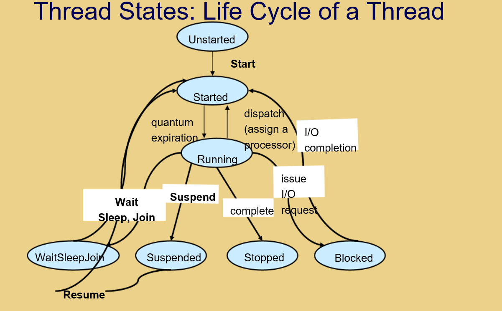
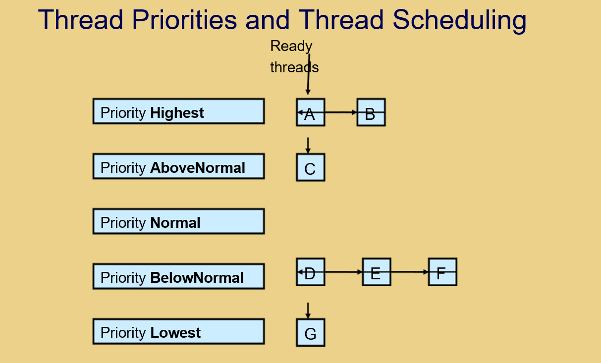
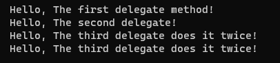

# Threads and Delegates

## Behaviour of a Program
* **Serial Processing:** A computer processor can execute only one instruction at a time following sequence, selection, and iteration.
* **Event-Driven Programs:** Appear different (user clicks a component, and associated code executes), but are actually driven by an event-loop checking each component sequentially while obeying the 3 laws of serial processing.

## Multitasking (Concurrency)
* Computers appear to run multiple programs at once (e.g., running VLC Player while reading email).
* **Multitasking:** Sharing the processor between programs by executing a bit of Program 1, then a bit of Program 2, and so on. Because computers are extremely fast, this creates the illusion of simultaneous execution.
* **Efficiency:** Multitasking is efficient because different tasks have varying processor demands (e.g., decoding a DVD is intensive, while printing a document is easy). Without it, the processor would sit idle waiting for slower tasks.
* **OS Supervision:** Operating systems detect misbehaving programs (like infinite loops) and manage scheduling, though most programs spend the majority of their time waiting.

## Multi-Core Technology & Threads
* **Multi-Core:** Effectively provides multiple processors, but standard serial programs do not automatically take advantage of multiple cores without explicit parallel design.
* **Threads:** While multitasking deals with running different programs, threads deal with **one program running more than one piece of code concurrently**.
* Built into core C# and Java languages.
* Crucial for GUI applications to prevent the user interface from locking up during heavy processing (e.g., displaying a progress bar).
* A thread is a lightweight process that can run at any time from within an existing program and share data with other threads. Managed by the CLR (C#) or JRE (Java).

## Thread States and Life Cycle


* **Unstarted:** Initial state where a thread starts its lifecycle. Remains here until the `Start()` method is called.
* **Started:** Remains here until the processor begins execution.
* **Running:** The highest priority started thread enters the running state and begins execution when assigned a processor.
* **Wait/Sleep/Join, Blocked, Suspended, Stopped:** Various non-running states caused by I/O requests, sleep intervals, synchronization, or termination. (Note: Methods like `Thread.stop()`, `resume()`, and `suspend()` are deprecated and unsafe).

## Thread Priorities and Scheduling


* **Priorities:** Lowest, BelowNormal, Normal (default), AboveNormal, and Highest. Managed using the `Priority` property.
* **Timeslicing:** Every thread is given a *quantum* (a short period of time) to execute before the processor switches to another thread, preventing threads from running exclusively to completion.
* **Thread Scheduler:** Keeps the highest priority thread running at all times using round-robin execution for threads of equal priority. Can occasionally cause **starvation** (postponement of low-priority thread execution).

## Using Threads in C#: Delegates
* Running a method as a thread requires **delegates**.
* **Delegates:** A safe way to pass a method as a parameter 
* (not available in Java, which uses the `Runnable` interface instead). 
* i.e. in Java we have no choice about the method it is set in the interface, in C#/C++ we can pass the method as a parameter. 
* It is made safe by using a delegate.
* A delegate specifies a template (signature) that a method must fit.
* **Declaration Example:**

```csharp
  delegate void MyDelegate(string s);
```

* **Instantiation & Invocation Example:**
```csharp
internal class Program
{
    delegate void MyDelegate(string s);
    private static void Main(string[] args)
    {
        MyDelegate aDelegate = new MyDelegate(Hello);
        aDelegate("The first delegate method"); // Invokes Hello with argument "A"
    }
    public static void Hello(string s)
    {
        Console.WriteLine("  Hello, {0}!", s);
    }
}
```
* **Concatenation:** Delegates can be combined (e.g., `MyDelegate c = a + b;`) so invoking `c("C")` calls multiple methods in sequence.
```csharp
 private static void Main(string[] args)
{
    MyDelegate aDelegate = new MyDelegate(Hello);
    MyDelegate anotherDelegate = new MyDelegate(Hello);
    MyDelegate combinedDelegate = aDelegate + anotherDelegate;
    aDelegate("The first delegate method"); // Invokes Hello with argument "A"
    anotherDelegate("The second delegate");
    combinedDelegate("The third delegate does it twice");
}
```


You have seen delegates previously. In the managed code of the form they are used to pass event methods.
When you add a button, for example, and then click on it to generate the button_click() method, it put the delegate in the managed code.
```csharp
button1.Click += button1_Click;
```

Note how it is using `+=`, that is because we can add delegates together like above and hence call several methods on the button click if we want to.
Java cannot do this as it doesn't have delegates and instead we must just use the method the interface expects, `actionPerformee(ActionEvent ae)` for example.

The point of this is that we must use delagates to use threads in C#.

## Threads in C#
* **Thread Class:** The `Thread` class is used to create and manage threads.
* We pass to it the method we want to run as a thread, which must match the signature of the delegate.
```csharp
Thread plusThread = new Thread(PrintPlus);
```
* The thread will run until the method completes, at which point it will terminate.
```csharp
static void PrintPlus()
{
    for (int i = 0; i < 100; i++)
    {
        Console.Write("+");
        Thread.Sleep(10);
    }
}
```
* The thread must be started with the `Start()` method:
```csharp
plusThread.Start();
```
### complete example
```csharp
namespace Thread
{
    using System;
    using System.Threading;

    class Program
    {
        static void Main()
        {
            // Create two separate threads and assign them their respective tasks
            Thread plusThread = new Thread(PrintPlus);
            Thread minusThread = new Thread(PrintMinus);

            // Start executing both threads concurrently
            plusThread.Start();
            minusThread.Start();

            // Wait for both threads to finish before exiting the main program
            plusThread.Join();
            minusThread.Join();

            Console.WriteLine("\nDone!");
        }

        static void PrintPlus()
        {
            for (int i = 0; i < 100; i++)
            {
                Console.Write("+");
                // A short delay forces the CPU to switch back and forth between threads
                Thread.Sleep(10);
            }
        }

        static void PrintMinus()
        {
            for (int i = 0; i < 100; i++)
            {
                Console.Write("-");
                Thread.Sleep(10);
            }
        }
    }
}
```
## Threads Form Example
This example is building [ThreadFlashExampleNew](https://github.com/LeedsBeckettUniversityASE/ThreadFlashExampleNew) found in the ASE repo.

Here we will create a thread to flash a button, using the simplified Thread class (we don't have to create our own delegate).

* Create a Form project and on the form make a button (leave it called button1).

* Inside the class, as instance data create a reference to thread, as we will want to use it throughout the class.
```csharp
 Thread newThread;
```

* Double click on your button so that it fills in the button click method.
* Now we want a method that is going to be run as out thread so create a method called, unimaginatively, ThreadMethod that returns cvoid and has no parameters.


```csharp
namespace ThreadsExample
{
    public partial class Form1 : Form
    {
        Thread newThread;
        public Form1()
        {
            Debug.WriteLine("thread 1");
            InitializeComponent();
        }

        private void button1_Click(object sender, EventArgs e)
        {

        }

        public void ThreadMethod()
        {
            Debug.WriteLine("thread 2");
        }
    }
}
```
* Now we will create a Thread object and pass our ThreadMethod(), we can do this because Thread provides a delegate that is void with no parameters and out method matches this.
* To make it start we must call our thread's start() method.

```csharp
    newThread = new Thread(ThreadMethod);   //create a thread passing the ThreadMethod() as the thread
    newThread.Start();
```

Run it and not much will happen, it will display on the debug console thread1 and thread2, then both threads exit and the form is just waiting for something to happen.

* Change the code so that it loops indefinitely.

```csharp
while (true)
{
    Debug.WriteLine("thread 2");
}
```
Now it doesn't exit and the console keeps saying "thread 2" while the form operates normally.

## Making it change the colour of the button
We need to make it flip the background colour of the button. It can be seen from the properties that a Button has a BackColor property.
It won't look good to just change it from one colour to another. We need to slow it down and give the display chance to update.
We can do this with `Thread.Sleep(milliseconds)` which will pause the thread for a given number of milliseconds.
I will also use a boolean variable (sometimes called a flag) to indicate which colour it should be.

`flag` should be declared as instace data.
```csharp
    while (true)
    {
                if (flag == false)
                {
                    this.button1.BackColor = Color.Red;

                }
                else
                {
                    this.button1.BackColor = Color.Gray;

                }
                flag = !flag;
                Thread.Sleep(500);
    }
                
```

* Note, if you exit by clicking the form's close button, it doesn't actually kill the application. Then when you try and run it again you will get an error saying it can't copy the exe.
* You will have to bring up the task manager (alt-ctrl-del), search for the name of your app and `end task`.

## Controlling the thread
The thread is flashing the background of the button and we could signal to it to stop doing this whilst leaving it active so it can star again.
Again we will use a boolean variable (flag) to indicate whether it should be flashing or not and signal it with the button.
* declare an instance boolean variable called `flashFlag` and set it to false
```csharp
    private void button1_Click(object sender, EventArgs e)
    {
        flashFlag = !flashFlag;
    }
```
Clicking the button will flip the flag. Next we need to read it in the thread and only flash the background if it is true.
```csharp
    while (true)
    {
        if (flashFlag == true)
        {
            if (flag == false)
            {
                this.button1.BackColor = Color.Red;
            }
            else
            {
                this.button1.BackColor = Color.Gray;
            }
            flag = !flag;
        }
        Thread.Sleep(500);
    }
```
 Note that when the user clicks the button it could be red or gray, you might want to set it back to gray.

 ## Stopping the thread
 Any methods used to stop a thread are deprecated and unsafe. The only safe way to stop a thread is to signal to it to stop.
 * Create another boolean flag, called endThreadFlag and set it to false.
 * Make the while loop `while (endThreadFlag == false)` and then when you want to stop the thread set endThreadFlag to true. Do this by creating a second button and setting the endThread flag in it's click method.
 
 ```csharp
    private void button2_Click(object sender, EventArgs e)
    {
        endThreadFlag = true;
    }
```
Now when the second button is clicked the thread will method will leave the loop and exit naturally.

## Ending the thread when the form closes
As notes above the thread still runs when the form is closed and this meant we had to kill the application with the debugger or the task manager.

We want the thread to stop when the form is closed. We can do this by setting endThread to true on the form's 'formClosing' event. 
In the event properties of the form select 'formClosing' and set the endThread flag.

```csharp
    private void Form1_FormClosing(object sender, FormClosingEventArgs e)
    {
        endThreadFlag = true;
    }
```
You may notice thatthe debugger exits when you close the form now, it didn't before because teh application (thread 2) was still running.
**remember you can't just paste code for event handlers in without doing it from the designer or adding the delegate call in the managed code. **

## The C# Timer
There is also a very simple way to use threads in C#. In the toolbox there is a component called Timer. 
This is a component that can be added to a form and it will run a method at regular intervals. 

* On the toolbox drag a Timer onto your form.
* It has one event method 'Tick()' which is called avery time time the Interval (property) is reached. 
* The interval is in milliseconds and can be set in the properties of the timer.
* Set the Interval property to 500 (half a second) and double click on the timer to create the Tick() method.
* You can start and stop the timed by setting its Enabled propert to true or false. 

```cshape
private void timer1_Tick(object sender, EventArgs e)
{
    Debug.Write("+");        
}
```
Why not get it to do something more exciting, like flashing the second button?

# Using Threads in Java

To run threads in Java, follow these steps:
1. **Import:** Import the `java.lang.Runnable` class.

Instead we will signal to the thread toi stop by changing the endThread flag when the form is closed.

This is achieved by 
2. **Implement:** Make your class implement the `Runnable` interface (e.g., `public class MyClass implements Runnable`).
3. **Reference:** Define a reference to a `Thread` class (`Thread myThread;`).
4. **Create:** Create a thread object (`myThread = new Thread(this, "name");`).
5. **Start:** Start the thread in initialization code (`myThread.start();`).
6. **Define Code:** Provide the code to execute concurrently inside the `run()` method:
   
```csharp
  Thread newThread;
```

Create a method which will be our thread. Note this is the second thread as our normal program is the first "thread of execution".
```csharp
    public void ThreadMethod()       
```

## Synchronized Methods
* Use the `synchronized` keyword for non-constructor methods (e.g., `public synchronized void method()`).
* Makes methods thread-safe by preventing multiple threads from calling the method simultaneously, avoiding memory inconsistencies.