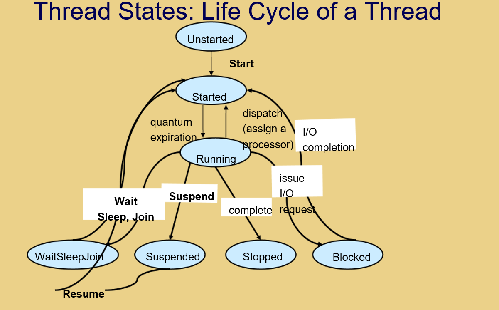
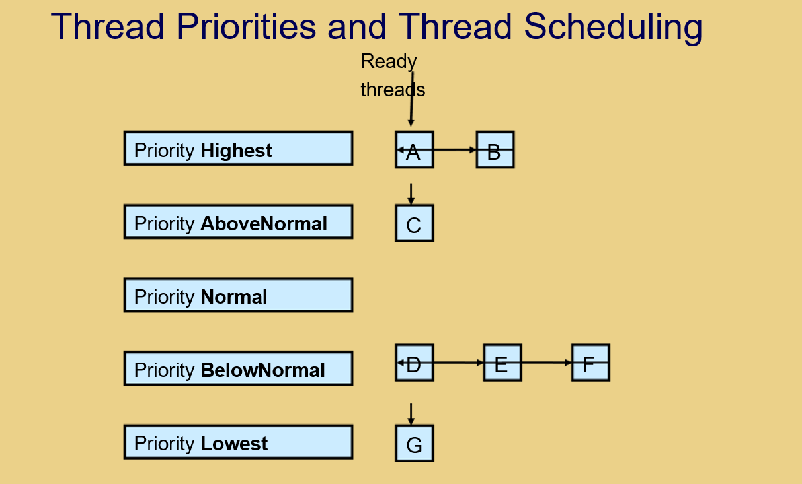
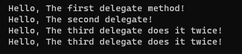

# Threads and Delegates

## Behaviour of a Program
* **Serial Processing:** A computer processor can execute only one instruction at a time following sequence, selection, and iteration.
* **Event-Driven Programs:** Appear different (user clicks a component, and associated code executes), but are actually driven by an event-loop checking each component sequentially while obeying the 3 laws of serial processing.

## Multitasking (Concurrency)
* Computers appear to run multiple programs at once (e.g., running VLC Player while reading email).
* **Multitasking:** Sharing the processor between programs by executing a bit of Program 1, then a bit of Program 2, and so on. Because computers are extremely fast, this creates the illusion of simultaneous execution.
* **Efficiency:** Multitasking is efficient because different tasks have varying processor demands (e.g., decoding a DVD is intensive, while printing a document is easy). Without it, the processor would sit idle waiting for slower tasks.
* **OS Supervision:** Operating systems detect misbehaving programs (like infinite loops) and manage scheduling, though most programs spend the majority of their time waiting.

## Multi-Core Technology & Threads
* **Multi-Core:** Effectively provides multiple processors, but standard serial programs do not automatically take advantage of multiple cores without explicit parallel design.
* **Threads:** While multitasking deals with running different programs, threads deal with **one program running more than one piece of code concurrently**.
* Built into core C# and Java languages.
* Crucial for GUI applications to prevent the user interface from locking up during heavy processing (e.g., displaying a progress bar).
* A thread is a lightweight process that can run at any time from within an existing program and share data with other threads. Managed by the CLR (C#) or JRE (Java).

## Thread States and Life Cycle


* **Unstarted:** Initial state where a thread starts its lifecycle. Remains here until the `Start()` method is called.
* **Started:** Remains here until the processor begins execution.
* **Running:** The highest priority started thread enters the running state and begins execution when assigned a processor.
* **Wait/Sleep/Join, Blocked, Suspended, Stopped:** Various non-running states caused by I/O requests, sleep intervals, synchronization, or termination. (Note: Methods like `Thread.stop()`, `resume()`, and `suspend()` are deprecated and unsafe).

## Thread Priorities and Scheduling


* **Priorities:** Lowest, BelowNormal, Normal (default), AboveNormal, and Highest. Managed using the `Priority` property.
* **Timeslicing:** Every thread is given a *quantum* (a short period of time) to execute before the processor switches to another thread, preventing threads from running exclusively to completion.
* **Thread Scheduler:** Keeps the highest priority thread running at all times using round-robin execution for threads of equal priority. Can occasionally cause **starvation** (postponement of low-priority thread execution).

## Using Threads in C#: Delegates
* Running a method as a thread requires **delegates**.
* **Delegates:** A safe way to pass a method as a parameter 
* (not available in Java, which uses the `Runnable` interface instead). 
* i.e. in Java we have no choice about the method it is set in the interface, in C#/C++ we can pass the method as a parameter. 
* It is made safe by using a delegate.
* A delegate specifies a template (signature) that a method must fit.
* **Declaration Example:**
* 
```csharp
  delegate void MyDelegate(string s);
```

* **Instantiation & Invocation Example:**
```csharp
internal class Program
{
    delegate void MyDelegate(string s);
    private static void Main(string[] args)
    {
        MyDelegate aDelegate = new MyDelegate(Hello);
        aDelegate("The first delegate method"); // Invokes Hello with argument "A"
    }
    public static void Hello(string s)
    {
        Console.WriteLine("  Hello, {0}!", s);
    }
}
```
* **Concatenation:** Delegates can be combined (e.g., `MyDelegate c = a + b;`) so invoking `c("C")` calls multiple methods in sequence.
```csharp
 private static void Main(string[] args)
{
    MyDelegate aDelegate = new MyDelegate(Hello);
    MyDelegate anotherDelegate = new MyDelegate(Hello);
    MyDelegate combinedDelegate = aDelegate + anotherDelegate;
    aDelegate("The first delegate method"); // Invokes Hello with argument "A"
    anotherDelegate("The second delegate");
    combinedDelegate("The third delegate does it twice");
}
```


The point of this is that we must use delagates to use threads in C#
## Using Threads in Java
To run threads in Java, follow these steps:
1. **Import:** Import the `java.lang.Runnable` class.
2. **Implement:** Make your class implement the `Runnable` interface (e.g., `public class MyClass implements Runnable`).
3. **Reference:** Define a reference to a `Thread` class (`Thread myThread;`).
4. **Create:** Create a thread object (`myThread = new Thread(this, "name");`).
5. **Start:** Start the thread in initialization code (`myThread.start();`).
6. **Define Code:** Provide the code to execute concurrently inside the `run()` method:
   ```java
   public void run() {
       // Thread execution code
   }
   ```

## Synchronized Methods
* Use the `synchronized` keyword for non-constructor methods (e.g., `public synchronized void method()`).
* Makes methods thread-safe by preventing multiple threads from calling the method simultaneously, avoiding memory inconsistencies.